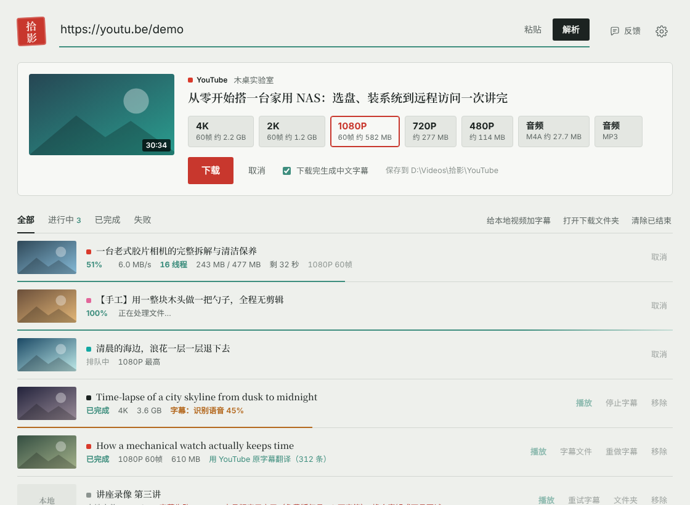
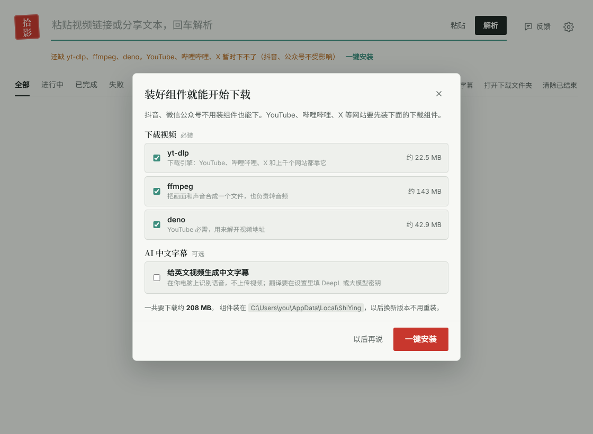
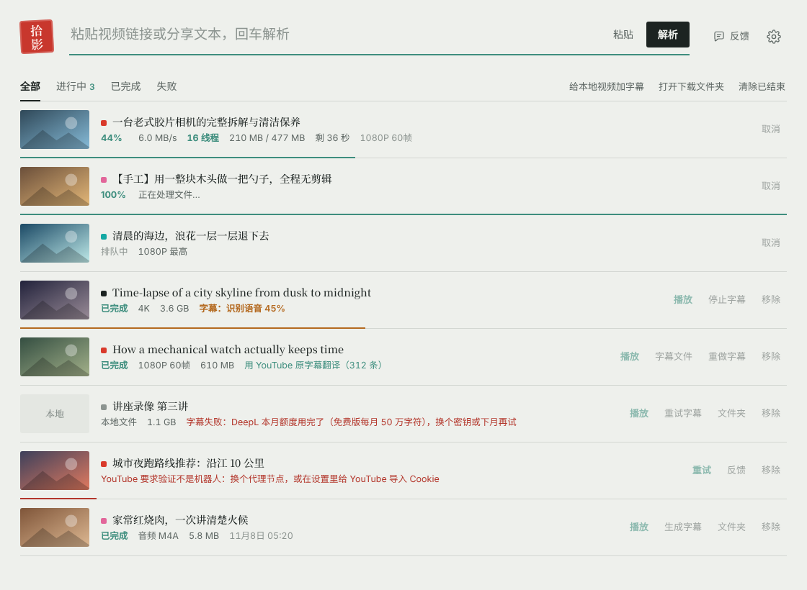
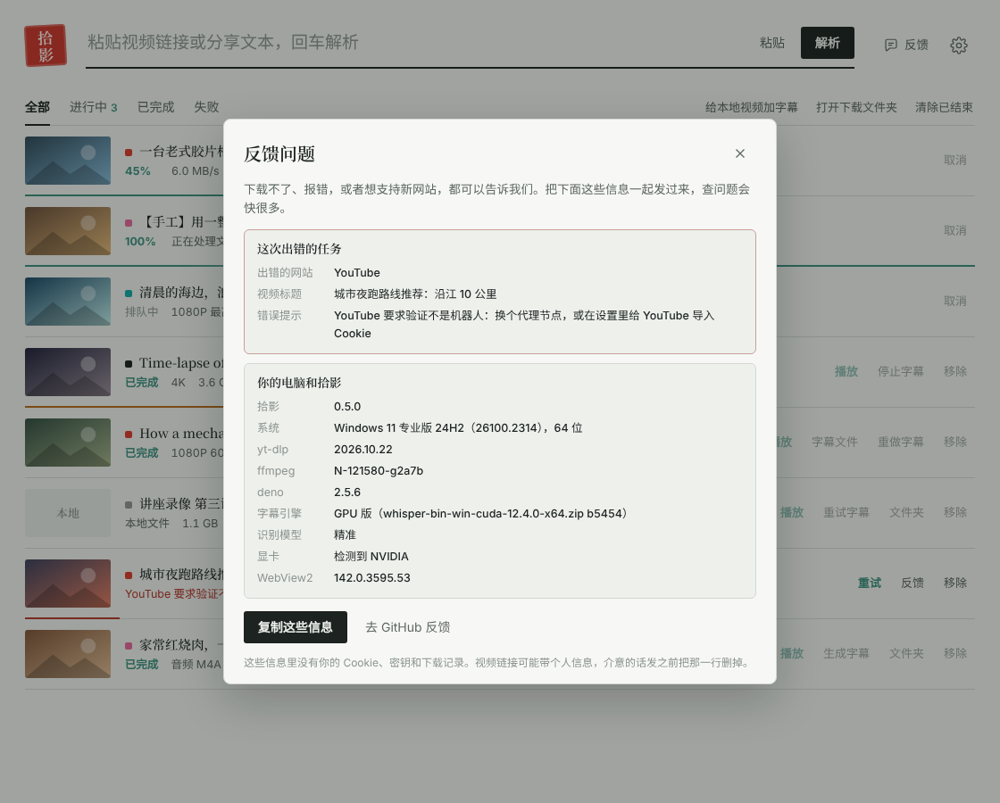

# ShiYing (拾影)

**A free, open-source Windows video downloader with a GUI.** Paste a link to download videos from Douyin (Chinese TikTok, no watermark), WeChat Official Account articles, Bilibili, YouTube and X (Twitter), with IDM-style multi-connection acceleration. English videos can get AI-generated Chinese subtitles (local Whisper speech recognition, translated by DeepL or any OpenAI-compatible LLM). It is a graphical frontend for [yt-dlp](https://github.com/yt-dlp/yt-dlp) with its own Douyin and WeChat parsers; on first launch a setup wizard installs everything it needs in one click. The interface is in Chinese.

**[Download ShiYing (ShiYing-windows-x64.zip)](https://github.com/Jaqennn/ShiYing/releases/latest/download/ShiYing-windows-x64.zip)** · [Install](#install) · [FAQ](#faq) · [Feedback](#feedback) · [中文说明](README.md)



## What it solves

- yt-dlp is great, but it is a command-line tool, and it can't download from Douyin or WeChat articles.
- Video apps let you watch online only; saved copies carry watermarks, or download slowly.
- English videos have no Chinese subtitles, and making them by hand is tedious.
- Downloader tools often need several extra programs on first use, hidden away in settings.

ShiYing puts all of this in one window: copy a link, switch back to ShiYing, it recognises the link, you pick a quality and click download.

## Highlights

- Free and open source, no ads, no account
- Recognises links and whole share texts (「7.43 复制打开抖音……」, 「【标题】https://b23.tv/xxx」); paste several links to batch-download
- First launch: a setup wizard installs the components in one click, with an overall progress bar, speed and time left; if GitHub is slow in mainland China, switch to a download mirror with one click. Every file is checked against the official SHA-256
- Multi-connection downloads: 16 connections per file, 70–90 MB/s in our tests, on par with IDM
- AI subtitles run speech recognition on your own PC (videos are not uploaded); the subtitle file has the same name as the video, so PotPlayer loads it automatically
- The package is about 14 MB and runs after unzipping; components live in a fixed folder, so new versions don't need them reinstalled

## Supported sites

The five optimised sites, ordered by number of users (the Chinese ones by QuestMobile's June 2026 monthly active users: WeChat 1.154 billion, Douyin 1.029 billion, Bilibili outside the top 30; [source](https://news.qq.com/rain/a/20260804A08ZHK00)):

| Site | Downloaded by | Components needed | Notes |
|---|---|---|---|
| WeChat Official Account articles | built-in parser | none (ffmpeg for audio-only) | Videos inside articles (`mp.weixin.qq.com/s/...`), highest quality by default (up to 1080p); every video in an article is downloaded; no login |
| Douyin | built-in parser | none (ffmpeg for audio-only) | No watermark, image posts in original resolution; no login |
| Bilibili | yt-dlp | yes | 480p/720p without login; import cookies for 1080p and above; 4K needs a premium account |
| YouTube | yt-dlp + Deno | yes | Needs a proxy in mainland China; Deno solves YouTube's signature challenge |
| X (Twitter) | yt-dlp | yes | Needs a proxy in mainland China; sensitive content needs cookies |
| 1700+ other sites | yt-dlp | yes | Xiaohongshu, Weibo, Vimeo, Twitch, Reddit and more; not specially tuned — [tell us](#feedback) if one fails |

Not supported: DRM-protected paid content (members-only films on iQIYI, Tencent Video, Netflix…) and WeChat Channels videos (encrypted).

## Requirements

- Windows 10 or Windows 11, 64-bit
- Microsoft Edge WebView2 Runtime: built into Windows 11, already present on almost every Windows 10 PC
- Disk: ShiYing itself is under 30 MB; the components are about 260 MB to download and take about 460 MB once unpacked; AI subtitles need another 0.2–1.3 GB download (CPU engine + fast model at the low end, GPU engine + accurate model at the high end), a bit more once unpacked

## Download

**[Download ShiYing-windows-x64.zip](https://github.com/Jaqennn/ShiYing/releases/latest/download/ShiYing-windows-x64.zip)** — this link always points to the latest version.

Or open the [release page](https://github.com/Jaqennn/ShiYing/releases/latest) and click `ShiYing-windows-x64.zip` under Assets. "Source code (zip)" and "Source code (tar.gz)" there are the source code; you don't need them.

## Install

### Option 1: unzip and run (recommended)

1. Right-click `ShiYing-windows-x64.zip` → "Extract All", into a normal folder such as `D:\Tools\ShiYing`. Not `C:\Program Files` — ShiYing can't write there.
2. Open the extracted `ShiYing` folder and double-click `ShiYing.exe`. Keep it next to the `_internal` folder; move the whole folder if you want it elsewhere.
3. If "Windows protected your PC" appears, click "More info" → "Run anyway". ShiYing has no paid code-signing certificate, so Windows shows this the first time.
4. The setup wizard opens on first launch. Click 「一键安装」 (install) and wait for the progress bar: yt-dlp, ffmpeg and Deno are about 260 MB in total, a minute or two on a fast connection.
5. For a desktop shortcut: right-click `ShiYing.exe` → "Send to" → "Desktop (create shortcut)" (on Windows 11, click "Show more options" first).

If the wizard downloads slowly, click 「换加速镜像」 (use a mirror); if that doesn't help, turn on your proxy and retry. See the [FAQ](#faq).

### Option 2: let an AI agent install it

If you use an AI agent that can run commands on your PC (Claude Code, Codex and similar), send it:

> Please install ShiYing on my Windows PC by following https://github.com/Jaqennn/ShiYing/blob/main/docs/agent.md, then run the checks described there.

[docs/agent.md](docs/agent.md) lists every command: download, SHA-256 check, unzip, remove the "downloaded from the internet" mark, install components and verify.

### Upgrading

Close ShiYing, unzip the new `ShiYing-windows-x64.zip` over the old `ShiYing` folder. Settings, history, components and models are stored elsewhere, so nothing is lost and nothing needs reinstalling.

## First use

1. Open ShiYing and install the components (step 4 above). If something goes missing later, a bar at the top says 「还缺 xx」 with a 「一键安装」 button.
2. Copy a video link on your phone or in the browser, then switch back to ShiYing: it picks the link up from the clipboard. You can also paste it into the box at the top and press Enter.
3. Pick a quality and click 「下载」 (download). The list shows progress, speed, time left and how many connections are in use.
4. When it's done, click 「播放」 to play or 「文件夹」 to open the folder. Videos go to `Videos\拾影`, in one sub-folder per site.



## AI Chinese subtitles

ShiYing transcribes speech on your PC with whisper.cpp, translates with DeepL or an LLM, and writes subtitle files named after the video.

1. Install the engine and a model: tick 「给英文视频生成中文字幕」 in the setup wizard, or use Settings → 字幕 (Subtitles). With an NVIDIA GPU the GPU engine (about 650 MB, much faster) is chosen; otherwise the CPU engine (about 20 MB). Models: fast `base.en` (141 MB), balanced `small.en` (465 MB), accurate `large-v3-turbo` (547 MB, recommended, multilingual). Models come from hf-mirror.com by default, which works in mainland China without a proxy.
2. Add a translation key in Settings → 字幕: a DeepL Free key (500,000 characters a month), or any OpenAI-compatible API (DeepSeek, Qwen, Kimi…). Click 「检测」 to test it.
3. Tick 「下载完生成中文字幕」 when downloading, or click 「生成字幕」 on a finished video; for videos already on your PC, click 「给本地视频加字幕」.

| File (next to the video) | Content |
|---|---|
| `name.zh.srt` | Chinese |
| `name.zh-en.srt` | Chinese above, original below |
| `name.en.srt` | Original (off by default, can be enabled in settings) |

PotPlayer loads the subtitles automatically. YouTube videos with human-made English captions are translated from those captions, skipping recognition.



## FAQ

**"Windows protected your PC" — is it a virus?**
No. ShiYing doesn't have a Microsoft-trusted code-signing certificate, so Windows warns the first time. Click "More info" → "Run anyway". All the code is in this repository, and each release lists the SHA-256 of the zip so you can check it.

**My antivirus flags or deletes ShiYing.exe.**
Python programs packed with PyInstaller are often flagged by mistake. If you downloaded it from this repository's release page (and the SHA-256 matches), it is the original. You can add the ShiYing folder to your antivirus's trusted list and unzip again.

**The setup wizard is slow or can't reach GitHub.**
The components are downloaded from GitHub, which can be slow from mainland China. Try, in order:

1. Click 「换加速镜像」 in the wizard. The mirror is a third-party service; ShiYing checks every file against the official SHA-256 and deletes it if it doesn't match.
2. Turn on your proxy app's system proxy, then click 「重试没装上的」 (retry).
3. Download the files by hand and put them in the components folder (see [Where components live](#where-components-live)).

**How do I download Bilibili videos in 1080p or 4K?**
Without login Bilibili only serves 480p/720p. Export Bilibili's `cookies.txt` with a browser extension and import it in Settings → 高级设置 (Advanced) → 登录信息 (Login). 4K also needs a premium account.

**YouTube says "video unavailable" or "confirm you're not a bot".**
Make sure all three components are installed (YouTube needs Deno). If it still fails, switch proxy servers, or import YouTube cookies (preferably from a spare account).

**Downloads are slower than IDM.**
Multi-connection download is on by default (16 connections per file). Some sites throttle many connections; lower it to 8 in Settings → 高级设置.

## Uninstall completely

1. Delete the ShiYing folder (the one with `ShiYing.exe`).
2. Type `%LOCALAPPDATA%\ShiYing` in the Explorer address bar and delete that folder: components and models, the biggest part.
3. Type `%APPDATA%\ShiYing` and delete it: settings and download history.

Downloaded videos stay where you saved them (by default `Videos\拾影`).

## Feedback

- Click 「反馈」 at the top right: it lists your Windows version and the versions of ShiYing and each component. Click 「复制这些信息」 (copy) or 「去 GitHub 反馈」 (open GitHub).
- Failed downloads have their own 「反馈」 button, which also fills in the site and the error message.
- Or open an issue directly: [can't download / error](https://github.com/Jaqennn/ShiYing/issues/new?template=bug.yml), [support a new site / feature](https://github.com/Jaqennn/ShiYing/issues/new?template=site.yml).



## Cookies (login)

Since Chrome / Edge 127, cookies on Windows are encrypted at the system level and no third-party program can read them. So:

- Recommended: install the browser extension **Get cookies.txt LOCALLY**, sign in to the site, export `cookies.txt`, and choose that file in Settings → 高级设置 → 登录信息
- Or sign in with Firefox and choose "read from browser → firefox"

Douyin usually needs no cookies; if share-page parsing fails, you can paste a douyin.com cookie string in the same place as a fallback.

## Where components live

Components and models installed by the wizard go to `%LOCALAPPDATA%\ShiYing\` (`bin\`, `models\`), so new versions and rebuilds keep them; the source build and the exe share them. Settings and history are in `%APPDATA%\ShiYing\`.

ShiYing also looks in `bin\` next to the program (portable use), `bin\` in the project root when building from source, and the system PATH. To install by hand, put the files in any of these `bin\` folders:

- yt-dlp: <https://github.com/yt-dlp/yt-dlp/releases> (`yt-dlp.exe`)
- ffmpeg: <https://github.com/yt-dlp/FFmpeg-Builds/releases> (`ffmpeg.exe` and `ffprobe.exe` from `ffmpeg-master-latest-win64-gpl.zip`)
- Deno: <https://github.com/denoland/deno/releases> (`deno.exe` from `deno-x86_64-pc-windows-msvc.zip`)

## How it works

**Setup wizard**: downloads yt-dlp, ffmpeg and Deno in order (plus the optional speech engine and model), each file over several connections, stoppable at any time. Before downloading it looks up the official SHA-256 from the GitHub API and checks the file afterwards; with a mirror configured, GitHub URLs get the mirror prefix.

**Douyin** (`app/douyin.py`, no yt-dlp, no a_bogus signature): follow the short link to the item ID → request `iesdouyin.com/share/video/{id}` with a mobile UA and read `window._ROUTER_DATA` → replace `playwm` with `play` to drop the watermark, build candidate URLs for `ratio=1080p/720p/540p` and try them in order → image posts download the originals; if that fails and a cookie is set, fall back to the web detail page.

**WeChat articles** (`app/wechat.py`, no yt-dlp, no login): open the article with a desktop UA → `video_page_infos` → `mp_video_trans_info` in the page script lists direct URLs for every quality (`mpvideo.qpic.cn`; `format_id` 100xx is H.264, 101xx is H.265) → group them per video by file name, keep article order, pick the best by default → the URLs are time-signed, so a failed download re-opens the article for fresh URLs once → when no URL is available, the page's status flags (deleted, violation, under review, transcoding, region-blocked) explain why.

**Subtitles**: ffmpeg extracts 16 kHz audio → whisper.cpp transcribes (with Silero voice-activity detection to avoid garbage during intro music) → translation (DeepL gets the whole text with XML tags, keeping context and line alignment; LLMs get batches of 30 lines with preceding context) → SRT. Audio detected as Chinese is not translated.

```
main.py              entry point
app/
  api.py             API exposed to the UI
  setup.py           setup wizard: queue, overall progress, stop, retry with a mirror
  components.py      install and update yt-dlp / ffmpeg / Deno
  fetch.py           component and model downloads: multi-connection, stoppable, SHA-256 check
  feedback.py        system and version info shown on the feedback page
  tasks.py           parse cache, download queue, history
  ytdlp.py           yt-dlp subprocess wrapper: qualities, format selection, progress, error messages
  fastdl.py          multi-connection chunked download engine
  subtitle.py        subtitles: whisper.cpp, DeepL / LLM translation, SRT output
  douyin.py          Douyin parser and downloader
  wechat.py          WeChat article video parser and downloader
  detect.py          extract links from text, identify the platform
  settings.py        settings (%APPDATA%\ShiYing\settings.json)
  netutil.py         system proxy, clipboard, open folder
web/                 UI (HTML/CSS/JS, loaded by pywebview)
  mock.js            demo data when index.html is opened in a browser; add ?demo=setup for the wizard
tests/               python -m pytest tests -q
```

## Build from source

```bat
:: Python 3.12 recommended
run.bat          :: installs dependencies on first run
run.bat debug    :: with developer tools
build.bat        :: builds dist\ShiYing\ShiYing.exe (keep it next to the _internal folder)
```

Releases are made by the GitHub Actions Release workflow (Actions → Release → Run workflow): bump the version in `app/__init__.py` and write `docs/release-notes/<version>.md`. The workflow runs the tests on Windows, installs the components for real, opens the built app and runs the setup wizard, then packs and publishes the release with the SHA-256 appended to the notes.

## About

I write down needs from my own daily life and have AI (Claude) turn them into software; ShiYing is one of them. It started because downloading with the yt-dlp command line was tedious and Douyin didn't work. The code, tests and UI were written by AI; I write the requirements and test on my own PC.

Also by me:

- [LiteCast (轻投)](https://github.com/Jaqennn/LiteCast): a free, ad-free screen-mirroring receiver for Android TV — iPhone screen mirroring, AirPlay and the cast button in Android video apps (DLNA)

## Disclaimer and license

For personal study and for backing up content you have the right to keep. Follow each platform's terms of service and respect creators' copyright.

Downloading is powered by [yt-dlp](https://github.com/yt-dlp/yt-dlp) (Unlicense), [FFmpeg](https://ffmpeg.org) and [Deno](https://deno.com); speech recognition by [whisper.cpp](https://github.com/ggml-org/whisper.cpp) (MIT); the UI uses [pywebview](https://pywebview.flowrl.com).

ShiYing itself is MIT licensed.
