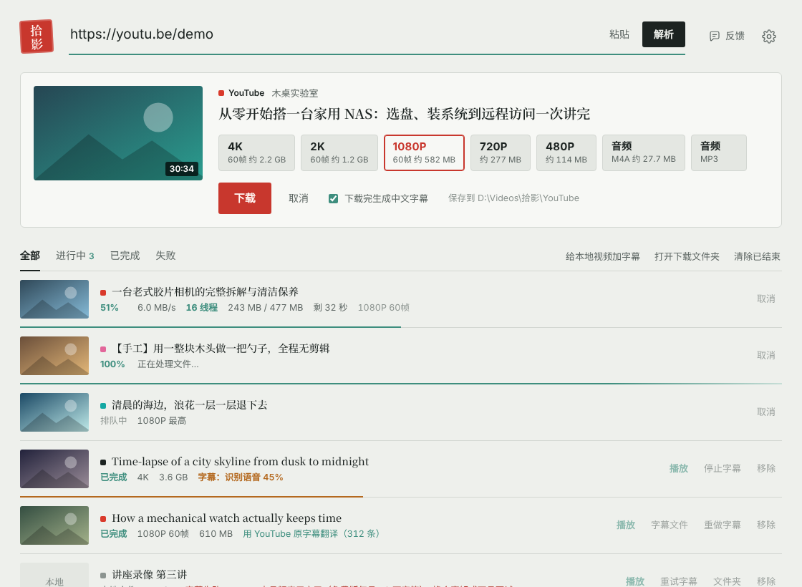
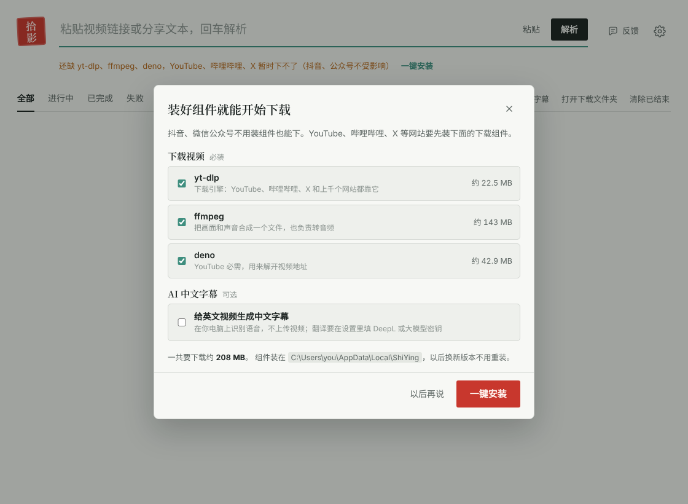
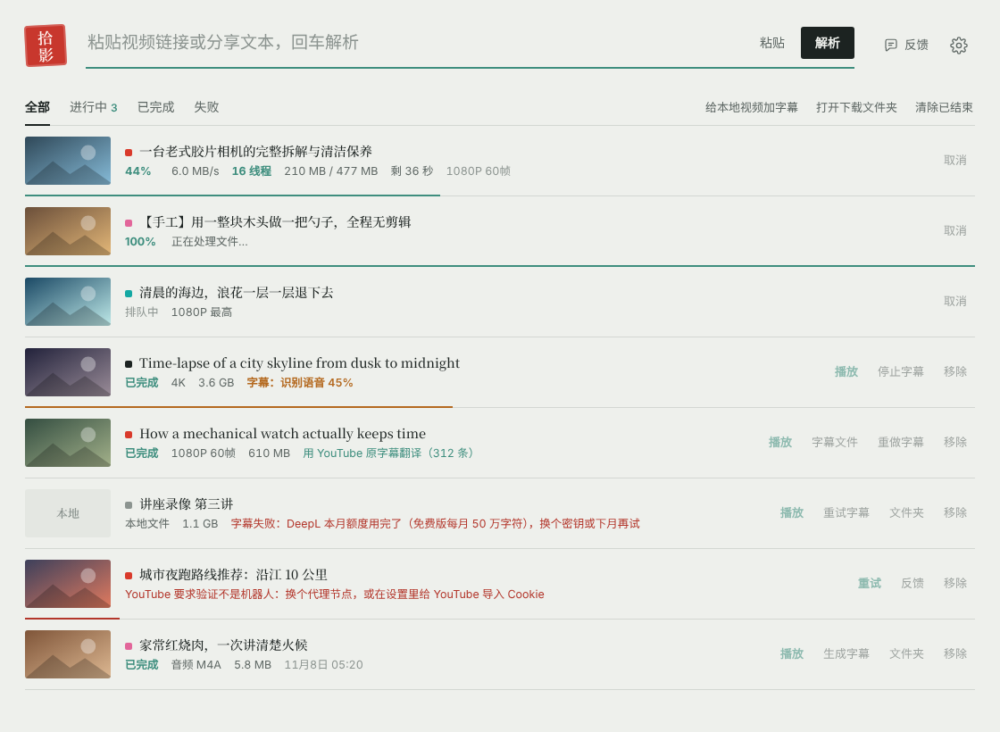
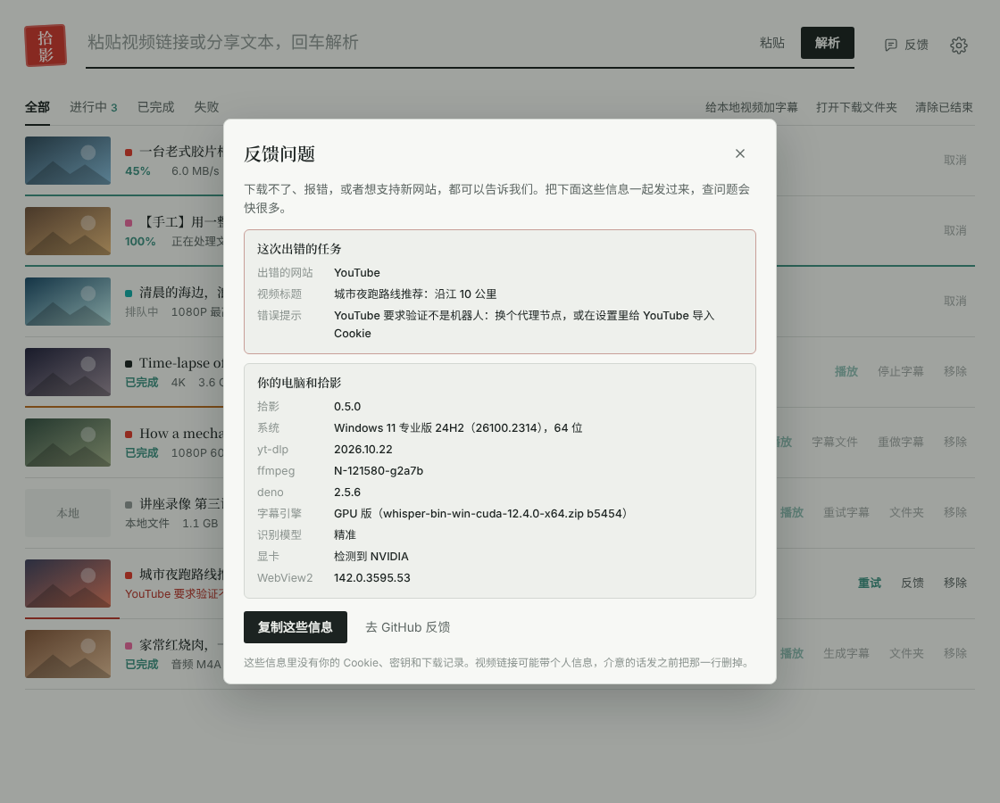

# 拾影 ShiYing

**免费开源的 Windows 视频下载器。** 粘贴链接就能下载抖音（无水印）、微信公众号、哔哩哔哩（B站）、YouTube、X（Twitter）的视频，像 IDM 一样多线程加速，还能用 AI 给英文视频生成中文字幕（Whisper 识别 + DeepL 翻译）。基于 yt-dlp，有图形界面，不用敲命令；第一次打开会弹出安装向导，一键装好需要的组件。

A free, open-source **Windows GUI video downloader** for Douyin (no watermark), WeChat Official Account articles, Bilibili, YouTube and X/Twitter, with multi-connection acceleration, a one-click component installer and AI-generated Chinese subtitles (Whisper + DeepL). A yt-dlp frontend — no command line needed. [English README](README.en.md)

**[下载拾影（ShiYing-windows-x64.zip）](https://github.com/Jaqennn/ShiYing/releases/latest/download/ShiYing-windows-x64.zip)** · [怎么安装](#安装) · [常见问题](#常见问题) · [反馈](#反馈) · [轻投 LiteCast：安卓电视投屏](https://github.com/Jaqennn/LiteCast)



## 解决什么问题

- yt-dlp 很好用，但要敲命令；抖音、公众号的视频它还下不了。
- 视频 App 里只能在线看，保存下来的带水印，或者下载很慢。
- 英文视频没有中文字幕，自己做字幕又太麻烦。
- 下载工具第一次用要装一堆东西，还得进设置一个个找。

拾影把这些放进一个窗口：复制链接，回到拾影就会自动认出来，选清晰度、点下载就行。

## 拾影的特点

- 免费、开源，没有广告，不用注册账号
- 认得出链接，也认得出整段分享文本（「7.43 复制打开抖音……」「【标题】https://b23.tv/xxx」）；几个链接一起粘贴可以批量下载
- 第一次打开一键装好组件，有总进度条、速度和剩余时间；国内下载慢可以一键换加速镜像，下完和官方校验值核对
- 多线程加速：每个文件 16 个连接同时下，实测 70～90 MB/s，和 IDM 相当
- AI 中文字幕在你电脑上识别语音，不上传视频；字幕和视频同名，PotPlayer 自动加载
- 安装包十几 MB，解压就能用；组件装在固定位置，换新版本不用重装

## 能下载哪些平台

专门优化过的五个平台，按使用人数从多到少排（国内三个按 QuestMobile 2026 年 6 月月活：微信 11.54 亿、抖音 10.29 亿，哔哩哔哩没有进前 30，[来源](https://news.qq.com/rain/a/20260804A08ZHK00)）：

| 平台 | 怎么下 | 要不要装组件 | 说明 |
|---|---|---|---|
| 微信公众号 | 拾影自带的解析模块 | 不用（只要音频时要 ffmpeg） | 文章里的视频，默认最高清晰度（公众号最高 1080P）；一篇有多个视频会全部下载；不用登录 |
| 抖音 | 拾影自带的解析模块 | 不用（只要音频时要 ffmpeg） | 无水印，支持图集原图；不用登录 |
| 哔哩哔哩 | yt-dlp | 要 | 不登录最高 480P / 720P，导入 Cookie 解锁 1080P 及以上，4K 要大会员 |
| YouTube | yt-dlp + deno | 要 | 需要代理；deno 用来解开 YouTube 的视频地址 |
| X（Twitter） | yt-dlp | 要 | 需要代理；敏感内容要 Cookie |
| 其他 1700 多个网站 | yt-dlp | 要 | 小红书、微博、Vimeo、Twitch、Reddit 等，没有专门优化，下不了欢迎[反馈](#反馈) |

下载不了的：有版权加密（DRM）的会员内容（比如爱奇艺、腾讯视频、Netflix 的会员片），以及视频号视频（加密的）。

<details>
<summary>yt-dlp 支持的常见网站</summary>

除了上面五个，其他链接都会交给 yt-dlp 解析，界面上会显示真实的网站名。

| 类型 | 网站 |
|---|---|
| 视频网站 | Vimeo、TED、Dailymotion、Rumble、niconico、AcFun、西瓜视频、知乎 |
| 直播平台（录播和剪辑） | Twitch、Kick、斗鱼、虎牙 |
| 社交平台 | Reddit、Facebook、Instagram、Bluesky、Pinterest、Tumblr、LinkedIn、微博、小红书 |
| 电视台 | BBC、NHK、ZDF、ARD、France TV、CBC、CCTV |
| 音频 | SoundCloud、Bandcamp（清晰度选「音频」） |
| 普通网页 | 网页里直接嵌的视频也可以试（通用解析） |

- 能不能下取决于网站当前的状态，网站改版后可能暂时失效；拾影打开时会自动检查 yt-dlp 更新，一般过一两天就能恢复。完整列表见 yt-dlp 的 [supportedsites.md](https://github.com/yt-dlp/yt-dlp/blob/master/supportedsites.md)
- Instagram、Facebook 等通常要登录：在设置 → 高级设置 → 登录信息里给「其他网站」导入 cookies.txt
- 电视台一般有地区限制，要用对应国家的代理节点；国内网站解析失败时，把代理设置里「其他」勾掉再试
</details>

## 需要什么电脑

- Windows 10 或 Windows 11，64 位
- Edge WebView2 运行时：Windows 11 自带，Windows 10 绝大多数已经装了
- 硬盘空间：拾影本身不到 30 MB；下载组件要下约 260 MB，解压装好后占约 460 MB；AI 中文字幕另外要下 0.2～1.3 GB（CPU 版引擎加快速模型最少，GPU 版引擎加精准模型最多），解压后会再大一些

## 下载

**[点这里下载 ShiYing-windows-x64.zip](https://github.com/Jaqennn/ShiYing/releases/latest/download/ShiYing-windows-x64.zip)**，这个链接永远是最新版。

也可以打开 [发布页](https://github.com/Jaqennn/ShiYing/releases/latest)，在 Assets 下面点 `ShiYing-windows-x64.zip`。同一个地方的「Source code (zip)」「Source code (tar.gz)」是源代码，不用下。

## 安装

### 方法一：解压就能用（推荐）

1. 右键下载好的 `ShiYing-windows-x64.zip` →「全部解压缩」，放到普通文件夹，比如 `D:\Tools\拾影`。不要放进 `C:\Program Files`，那里没有写入权限。
2. 打开解压出来的 `ShiYing` 文件夹，双击 `ShiYing.exe`。它要和旁边的 `_internal` 文件夹放在一起，想挪位置就整个文件夹一起挪。
3. 如果弹出「Windows 已保护你的电脑」，点「更多信息」→「仍要运行」。拾影没有买数字签名证书，第一次打开都会这样提示。
4. 第一次打开会弹出安装向导，点「一键安装」，等进度条走完。yt-dlp、ffmpeg、deno 一共要下载约 260 MB，网速快一两分钟就好。
5. 想以后方便打开：右键 `ShiYing.exe` →「发送到」→「桌面快捷方式」（Windows 11 要先点「显示更多选项」）。

安装向导下载很慢时，点「换加速镜像」；还不行就开代理再试，详见[常见问题](#常见问题)。

### 方法二：让 AI 帮你装

会用 AI 助手（比如 Claude、ChatGPT 的电脑操作功能，或者 Claude Code、Codex 这类能运行命令的工具）的话，把下面这段发给它：

> 请按 https://github.com/Jaqennn/ShiYing/blob/main/docs/agent.md 的步骤，在我的 Windows 电脑上安装拾影，装好后按里面的方法检查一遍。

[docs/agent.md](docs/agent.md) 里写了下载、解压、解除「来自网络」的标记、装组件和验收的每一步命令。

### 以后升级

下载新的 `ShiYing-windows-x64.zip`，解压后覆盖原来的 `ShiYing` 文件夹（先关掉拾影）。设置、下载记录、组件和模型都存在别的地方，升级不用重装、不会丢。

## 第一次使用

1. 打开拾影，装好组件（上一节第 4 步）。以后缺了什么，主页顶上会提示「还缺 xx」，点「一键安装」就行。
2. 在手机或浏览器里复制视频链接，回到拾影窗口，会自动认出剪贴板里的链接；也可以粘贴到最上面的输入框，按回车。
3. 选清晰度，点「下载」。下载列表里能看到进度、速度、剩余时间和用了几个线程。
4. 下完点「播放」直接看，或者点「文件夹」打开所在位置。视频默认存在「视频\拾影」文件夹里，按平台分好了子文件夹。



## AI 中文字幕

给英文视频生成中文字幕：在你电脑上用 whisper.cpp 识别语音，再用 DeepL 或大模型翻译，生成和视频同名的字幕文件。

1. 装引擎和模型：在安装向导里勾选「给英文视频生成中文字幕」，或者在设置 → 字幕里装。有 NVIDIA 显卡会自动用 GPU 版（约 650 MB，快很多），没有就用 CPU 版（约 20 MB）。识别模型三选一：快速 `base.en`（141 MB）、均衡 `small.en`（465 MB）、精准 `large-v3-turbo`（547 MB，推荐，支持多种语言）。模型默认从 hf-mirror.com 下载，国内不用代理。
2. 填翻译密钥：设置 → 字幕里填 DeepL 免费版密钥（每月 50 万字符），或者任何兼容 OpenAI 的大模型接口（DeepSeek、通义千问、Kimi 等），点「检测」确认能用。
3. 下载时勾选「下载完生成中文字幕」，或者在已下载的视频上点「生成字幕」；电脑里已有的视频点「给本地视频加字幕」。

| 生成的文件（和视频在同一文件夹） | 内容 |
|---|---|
| `视频名.zh.srt` | 中文 |
| `视频名.zh-en.srt` | 中文在上、原文在下 |
| `视频名.en.srt` | 原文（默认不生成，可以在设置里勾选） |

PotPlayer 打开视频会自动加载字幕；右键 → 字幕，可以在中文和中英双语之间切换。YouTube 视频有人工英文字幕时直接用原字幕翻译，跳过识别。



## 常见问题

**弹出「Windows 已保护你的电脑」，是病毒吗？**
不是。拾影没有买微软认可的数字签名证书，所以第一次打开会这样提示。点「更多信息」→「仍要运行」就行。拾影的代码全部公开在这个仓库里，发布页还写了安装包的 SHA-256，可以自己核对。

**杀毒软件报毒、把 ShiYing.exe 删了？**
用 PyInstaller 打包的 Python 程序常被误报。从本页的发布页下载的就是原版，可以在杀毒软件里把拾影文件夹加进信任区，再重新解压一次。

**安装向导下载很慢，或者提示连不上 GitHub？**
组件都是从 GitHub 下载的，国内直连有时很慢。按顺序试：

1. 点向导里的「换加速镜像」。镜像是第三方提供的，下完拾影会和官方校验值核对，对不上会删掉。
2. 开着代理软件（打开「系统代理」）再点「重试没装上的」。
3. 实在不行可以手动下载，放进组件文件夹（见下面「组件放在哪」）。

**抖音视频怎么下载无水印？**
在抖音里点分享 → 复制链接，回到拾影就会自动识别，整段分享口令直接粘贴也行。拾影有自己的抖音解析模块，不用登录、不用 Cookie、不用装组件，下载的是无水印原视频，图集会下载原图。

**公众号文章里的视频怎么下载？**
在微信里打开文章，点右上角「…」→「复制链接」，回到拾影就会自动识别（电脑版微信里点「用默认浏览器打开」后复制地址栏也行）。默认选最高清晰度，一般是 1080P。一篇文章里有多个视频时会全部下载，放在以文章标题命名的文件夹里。

- 视频号视频（文章里带视频号卡片的那种）是加密的，下载不了
- 老文章里嵌的腾讯视频会交给 yt-dlp 下载，要先装好组件
- 提示「环境异常」是微信觉得访问太频繁，等几分钟再试

**B站视频怎么下载 1080P 或 4K？**
不登录时 B站最高只给 480P / 720P。用浏览器扩展导出 B站的 `cookies.txt`，在设置 → 高级设置 → 登录信息里导入，就能下 1080P 高码率；4K 还要大会员账号。见下面的 [Cookie](#cookie登录信息) 一节。

**YouTube 下载提示「视频不可用」或「请确认你不是机器人」？**
先确认安装向导里的三个组件都装好了（YouTube 要用 deno）。还不行就换个代理节点，或者导入 YouTube 的 Cookie（建议用小号）。

**下载速度慢，比 IDM 慢很多？**
默认已经开了多线程加速：每个文件 16 个连接同时下。个别网站连接太多会被限速，可以在设置 → 高级设置里调成 8。

**yt-dlp 有图形界面吗？不会用命令行怎么用 yt-dlp？**
拾影就是 yt-dlp 的图形界面：粘贴链接、点清晰度、点下载。yt-dlp 作为组件放在旁边，拾影打开时会自动检查更新（两天最多一次），网站改版后一般很快就能恢复。

## 卸载干净

1. 删掉拾影的文件夹（里面有 `ShiYing.exe` 的那个）。
2. 在资源管理器地址栏输入 `%LOCALAPPDATA%\ShiYing`，删掉这个文件夹：里面是组件和识别模型，最占空间。
3. 再输入 `%APPDATA%\ShiYing`，删掉：里面是设置和下载记录。

下载好的视频在你设置的保存位置（默认「视频\拾影」），卸载不会删它们。

## 反馈

- 软件里点右上角「反馈」：会自动列出你的系统、拾影和各组件的版本，点「复制这些信息」，或者直接点「去 GitHub 反馈」。
- 下载失败的任务旁边也有「反馈」，会顺带填好出错的网站和错误提示。
- 也可以直接在 GitHub 上提：[下载不了 / 报错](https://github.com/Jaqennn/ShiYing/issues/new?template=bug.yml)、[想支持新网站 / 新功能](https://github.com/Jaqennn/ShiYing/issues/new?template=site.yml)。



## Cookie（登录信息）

Windows 上 Chrome / Edge 127 以后的 Cookie 被系统级加密，第三方程序都读不了，所以：

- 推荐：装浏览器扩展 **Get cookies.txt LOCALLY**，在对应网站登录后导出 `cookies.txt`，在设置 → 高级设置 → 登录信息里选择这个文件
- 或者：用 Firefox 登录，设置里选「从浏览器读 → firefox」

抖音一般不需要 Cookie。分享页解析失败时，可以在同一个地方粘贴 douyin.com 的 Cookie 字符串兜底。

## 组件放在哪

安装向导装的组件和识别模型都放在 `%LOCALAPPDATA%\ShiYing\`（`bin\`、`models\`），换新版本、重新打包都不会丢，源码运行和 exe 共用一份。设置和下载记录在 `%APPDATA%\ShiYing\`。

拾影也认这些位置：程序旁边的 `bin\`（便携用法）、从源码打包时项目根目录的 `bin\`、系统 PATH。想手动下载就放进任意一个 `bin\`：

- yt-dlp：<https://github.com/yt-dlp/yt-dlp/releases>（`yt-dlp.exe`）
- ffmpeg：<https://github.com/yt-dlp/FFmpeg-Builds/releases>（`ffmpeg-master-latest-win64-gpl.zip` 里的 `ffmpeg.exe`、`ffprobe.exe`）
- deno：<https://github.com/denoland/deno/releases>（`deno-x86_64-pc-windows-msvc.zip` 里的 `deno.exe`）

## 工作原理

**安装向导**：按顺序下载 yt-dlp、ffmpeg、deno（以及可选的识别引擎和模型），每个文件用多个连接同时下，能随时停止。下载前先从 GitHub 接口查到官方发布的 SHA-256，下完核对，对不上就删掉。设置了加速镜像时，GitHub 的地址前面会加上镜像前缀。

**抖音模块**（`app/douyin.py`，不依赖 yt-dlp，也不需要 a_bogus 签名）：短链跟随跳转拿到作品 ID → 用手机 UA 请求 `iesdouyin.com/share/video/{id}`，从 `window._ROUTER_DATA` 取作品数据 → `playwm` 换成 `play` 去水印，按 `ratio=1080p/720p/540p` 生成候选地址，下载时逐个尝试 → 图集直接下原图；失败且填了 Cookie 时，请求网页版详情页兜底。

**公众号模块**（`app/wechat.py`，不依赖 yt-dlp，不用登录）：用电脑浏览器 UA 打开文章页 → 页面脚本里的 `video_page_infos` → `mp_video_trans_info` 列出了每个视频的各档直链（`mpvideo.qpic.cn`，`format_id` 100xx 是 H.264，101xx 是 H.265）→ 按文件名把同一个视频的各档归到一起，按正文顺序排列，默认选最高档 → 直链带时效签名，下载失败时重新打开文章拿新地址再试一次 → 拿不到地址时，按页面里的状态标记（删除、违规、审核中、转码中、海外限制）给出原因。

**字幕**：ffmpeg 提取 16kHz 音频 → whisper.cpp 识别（带 Silero 静音检测，减少片头音乐乱出字）→ 按条翻译（DeepL 用 XML 标签整段发送，既有上下文又能逐条对齐；大模型按 30 条一组、带前文）→ 写 SRT。识别出的语言本来就是中文时不翻译。

```
main.py              入口
app/
  api.py             暴露给界面的接口
  setup.py           安装向导：排队安装、汇总进度、停止、换镜像重来
  components.py      yt-dlp / ffmpeg / deno 的安装和更新
  fetch.py           组件和模型的下载：多连接、可停止、核对官方 SHA-256
  feedback.py        反馈页显示的系统和版本信息
  tasks.py           解析缓存、下载队列、历史记录
  ytdlp.py           yt-dlp 子进程封装：清晰度整理、选格式、进度解析、报错翻译
  fastdl.py          多连接分块下载引擎
  subtitle.py        字幕：whisper.cpp 识别、DeepL / 大模型翻译、SRT 输出
  douyin.py          抖音解析和下载
  wechat.py          微信公众号文章视频解析和下载
  detect.py          从文本里抠出链接、认出平台
  settings.py        设置（%APPDATA%\ShiYing\settings.json）
  netutil.py         系统代理、剪贴板、打开文件夹
web/                 界面（HTML/CSS/JS，pywebview 加载）
  mock.js            直接用浏览器打开 index.html 时的演示数据，加 ?demo=setup 看安装向导
tests/               python -m pytest tests -q
```

## 从源码构建

```bat
:: 推荐 Python 3.12
run.bat          :: 第一次会自动装依赖
run.bat debug    :: 带开发者工具
build.bat        :: 打包成 dist\ShiYing\ShiYing.exe（要和旁边的 _internal 文件夹放在一起）
```

发布用 GitHub Actions 的 Release 工作流（Actions → Release → Run workflow）：先改 `app/__init__.py` 里的版本号、写好 `docs/release-notes/<版本>.md`，工作流会在 Windows 上跑测试、真实安装一遍组件、打开打包好的程序检查安装向导，再打包发布，并在发布说明末尾附上 SHA-256。

## 关于这个项目

我把自己日常碰到的需求记下来，再用 AI（Claude）把它们做成软件，拾影是其中一个：起因是平时用 yt-dlp 命令行下视频太麻烦，抖音还下不了。代码、测试和界面都是 AI 写的，我负责提需求和在自己电脑上实测。

同系列的其他项目：

- [轻投 LiteCast](https://github.com/Jaqennn/LiteCast)：免费无广告的安卓电视投屏接收端，iPhone 屏幕镜像、AirPlay 和安卓手机的投屏按钮都能用

## 声明和许可

仅供个人学习、备份自己有权保存的内容。请遵守各平台的用户协议，尊重创作者版权。

下载能力来自 [yt-dlp](https://github.com/yt-dlp/yt-dlp)（Unlicense）、[FFmpeg](https://ffmpeg.org)、[Deno](https://deno.com)，字幕识别来自 [whisper.cpp](https://github.com/ggml-org/whisper.cpp)（MIT），界面基于 [pywebview](https://pywebview.flowrl.com)。

拾影本身使用 MIT 许可。
