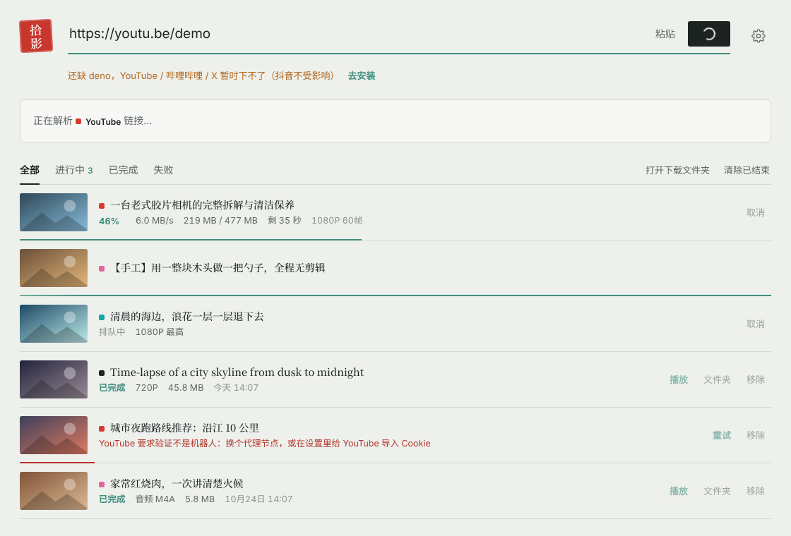
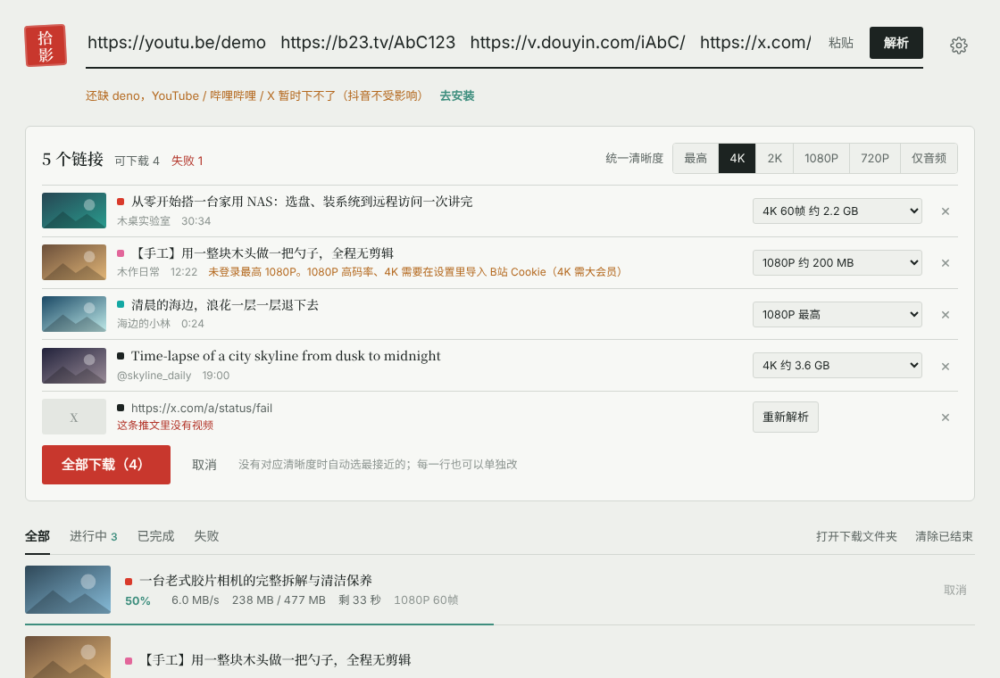
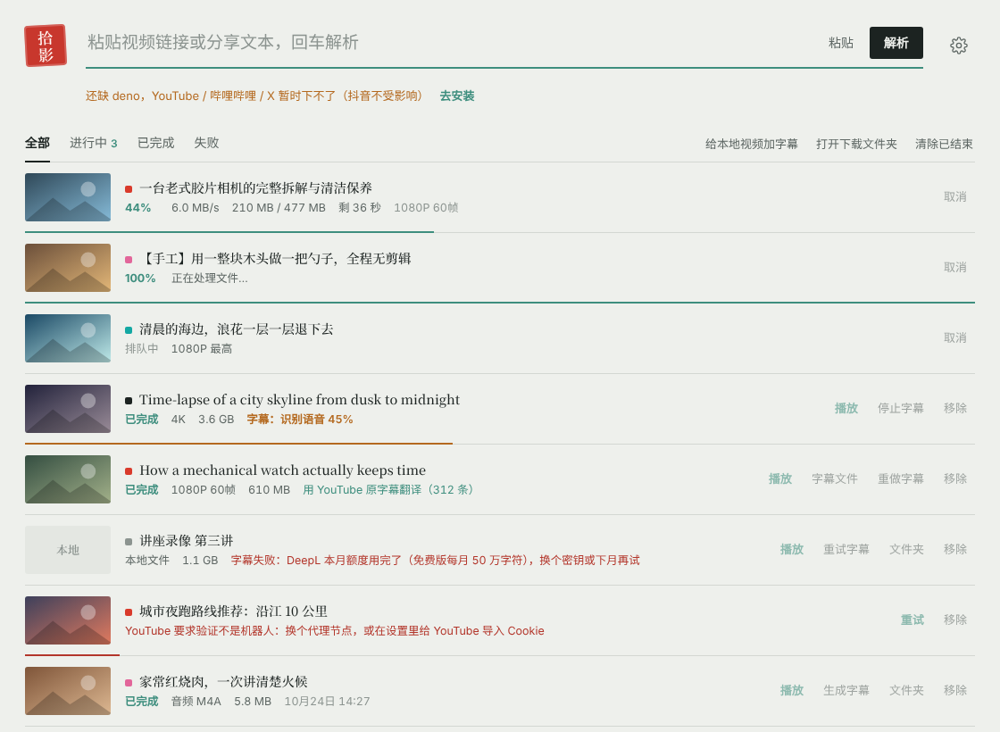

# 拾影 ShiYing

**免费开源的 Windows 视频下载器。** 粘贴链接就能下载 YouTube、哔哩哔哩（B站）、X（Twitter）、抖音视频（抖音无水印），像 IDM 一样多线程加速，还能用 AI 给英文视频生成中文字幕（Whisper 识别 + DeepL 翻译）。基于 yt-dlp，有图形界面，不用敲命令。

A free, open-source **Windows GUI video downloader** for YouTube, Bilibili, X/Twitter and Douyin (no watermark), with multi-connection acceleration and AI-generated Chinese subtitles (Whisper + DeepL). A yt-dlp frontend — no command line needed. [English README](README.en.md)

[下载最新版](https://github.com/Jaqennn/ShiYing/releases/latest) · [常见问题](#常见问题) · [轻投 LiteCast：安卓电视投屏](https://github.com/Jaqennn/LiteCast)





| 平台 | 下载方式 | 说明 |
|---|---|---|
| YouTube | yt-dlp + Deno | 需要代理；Deno 用来解 YouTube 的签名 |
| 哔哩哔哩 | yt-dlp | 未登录最高 480P/720P，导入 Cookie 解锁 1080P 及以上 |
| X (Twitter) | yt-dlp | 需要代理；敏感内容需 Cookie |
| 抖音 | 内置解析模块 | 无水印，支持图集；不需要登录 |
| 其他 | yt-dlp | yt-dlp 支持的上千个网站都可以试 |

## 功能

- **批量**：几个平台的链接一起粘贴（换行、空格隔开、甚至连在一起都行），一键解析，统一选清晰度，一键全部下载
- **多线程加速**：像 IDM 一样把文件切块、16 个连接同时下；m3u8/DASH 分片流用 yt-dlp 并发分片；加速失败自动回退
- **中文字幕**：下载完（或任意本地视频）一键生成中文字幕。Whisper 在本机识别语音，DeepL 或大模型（DeepSeek 等）翻译，输出和视频同名的 `.zh.srt` / `.zh-en.srt`，PotPlayer 自动加载
- 识别链接和分享文本：`7.43 复制打开抖音…https://v.douyin.com/xxx/`、`【标题】https://b23.tv/xxx`、裸 `BV号` 都行
- 切回窗口时自动发现剪贴板里的链接；也支持 Ctrl+V、拖拽
- 清晰度一目了然：4K / 2K / 1080P 60帧 …，带预估大小；仅音频 M4A / MP3
- **兼容优先**（默认开）：同清晰度下选 H.264 + AAC，合并成 MP4，Windows 自带播放器直接能放
- 下载队列：进度、速度、剩余时间、取消、重试、并发数可调；关掉程序后记录还在
- 代理：默认 YouTube / X 走系统代理（Clash 等开“系统代理”即可），B站 / 抖音直连；可手动指定
- 组件一键安装 / 更新：网站改版时点一下“检查更新”就能修好，不用重新打包软件
- 浅色 / 深色主题

## 运行

### 直接用打包好的 exe

1. 到 Releases 下载 `ShiYing-windows-x64.zip`，解压到普通目录（如 `D:\Tools\拾影`，不要放 `C:\Program Files`）
2. 打开 `ShiYing.exe` → 右上角设置 → 组件 → 依次安装 yt-dlp、ffmpeg、deno
3. 复制视频链接，回到窗口

> 需要 Windows 10/11 和 Edge WebView2 运行时（Win11 自带，Win10 绝大多数已装）。

### 从源码运行

```bat
:: Python 3.12 推荐
run.bat          :: 首次自动装依赖
run.bat debug    :: 带开发者工具
```

### 自己打包

```bat
build.bat        :: 输出 dist\ShiYing\ShiYing.exe（要和旁边的 _internal 文件夹放在一起）
```

推送 `v*` 标签时 GitHub Actions 会自动打包并发布 Release。

## 组件放在哪

在设置里一键安装的组件和识别模型统一放在 `%LOCALAPPDATA%\ShiYing\`（`bin\`、`models\`）。重新打包、换新版本都不会丢，源码运行和 exe 共用一份。

程序也会认这些位置：程序旁边的 `bin\`（便携用法）、从源码打包时项目根目录的 `bin\`、系统 PATH。手动下载的话放进上面任意一个 `bin\`：

- yt-dlp：<https://github.com/yt-dlp/yt-dlp/releases>
- ffmpeg：<https://github.com/yt-dlp/FFmpeg-Builds/releases>（win64-gpl）
- deno：<https://github.com/denoland/deno/releases>（x86_64-pc-windows-msvc）

GitHub 下不动时，在设置里填一个 GitHub 加速前缀。

设置和下载记录在 `%APPDATA%\ShiYing\`。

## Cookie（登录信息）

Windows 上 Chrome / Edge 127+ 的 Cookie 被系统级加密，任何第三方程序都读不了，所以：

- 推荐：装浏览器扩展 **Get cookies.txt LOCALLY**，在对应网站登录后导出 `cookies.txt`，在设置里选择该文件（`.gitignore` 已排除 `*cookies*.txt`，放在项目文件夹里也不会被传到 GitHub）
- 或者：用 Firefox 登录，设置里选“从浏览器读 → firefox”

抖音一般不需要 Cookie。若分享页解析失败，可在设置里粘贴 douyin.com 的 Cookie 字符串作为兜底。

## 中文字幕



设置 → 字幕：

1. **识别引擎**：有 NVIDIA 显卡装 GPU 版（约 650MB，快很多），否则装 CPU 版（约 20MB）
2. **识别模型**：快速 `base.en` / 均衡 `small.en` / 精准 `large-v3-turbo`（推荐，多语言）。默认从 hf-mirror.com 下载，国内不用代理
3. **翻译**：填 DeepL 免费密钥（每月 50 万字符），或任何兼容 OpenAI 的大模型接口（DeepSeek、通义千问、Kimi…）。点「检测」确认能用
4. 下载时勾选「下载完生成中文字幕」，或在已完成的视频上点「生成字幕」；本地视频点「给本地视频加字幕」

流程：ffmpeg 提取 16kHz 音频 → whisper.cpp 识别（带 Silero 静音检测，减少片头音乐乱出字）→ 按条翻译（DeepL 用 XML 标签整段发送，既有上下文又能逐条对齐；大模型按 30 条一组、带前文）→ 写 SRT。YouTube 视频有人工英文字幕时直接用原字幕，跳过识别。识别出的语言本来就是中文时不翻译。

生成的文件（和视频在同一文件夹）：

| 文件 | 内容 |
|---|---|
| `视频名.zh.srt` | 中文 |
| `视频名.zh-en.srt` | 中文在上、原文在下 |
| `视频名.en.srt` | 原文（默认不生成，可在设置里勾选） |

## 常见问题

**抖音视频怎么下载无水印？**
在抖音里点分享 → 复制链接，回到拾影就会自动识别，整段分享口令（「7.43 复制打开抖音……」）直接粘贴也行。拾影有独立的抖音解析模块，不需要登录、不需要 Cookie，下载的是无水印原视频，图集会下载原图。

**B站视频怎么下载 1080P 或 4K？**
不登录时 B站最高只给 480P / 720P。用浏览器扩展导出 B站的 `cookies.txt`，在设置里导入后就能下 1080P 高码率；4K 还需要大会员账号。见下面的 [Cookie](#cookie登录信息) 一节。

**yt-dlp 有图形界面吗？不会用命令行怎么用 yt-dlp？**
拾影就是 yt-dlp 的图形界面：粘贴链接、点清晰度、点下载。yt-dlp 本身作为组件放在旁边，网站改版时在设置里点「检查更新」即可，不用等拾影更新。

**YouTube 下载提示「视频不可用」或「请确认你不是机器人」？**
先在设置 → 组件里更新 yt-dlp 并安装 Deno（YouTube 现在要用它解签名）。还不行就换个代理节点，或者导入 YouTube 的 Cookie（建议用小号）。

**下载速度慢，比 IDM 慢很多？**
默认已开多线程加速：每个文件 16 个连接同时下载。实测和 IDM 速度相当（70～90 MB/s）。个别网站连接数太多会被限速，可以在设置里调成 8。

**怎么给英文视频生成中文字幕？PotPlayer 能直接显示吗？**
设置 → 字幕里装好识别引擎和模型、填 DeepL 密钥，下载时勾选「下载完生成中文字幕」，或在已下载的视频上点「生成字幕」。字幕和视频同名、放在同一文件夹，PotPlayer 打开视频会自动加载；右键 → 字幕可以切换中文 / 中英双语。

**电脑里已有的视频能加字幕吗？**
能。点「给本地视频加字幕」，选一个或多个视频即可。

## 抖音模块原理

`app/douyin.py`，不依赖 yt-dlp，也不需要 a_bogus 签名：

1. 短链跟随跳转拿到作品 ID（支持 `/video/`、`/note/`、`modal_id=` 等形式）
2. 用手机 UA 请求 `iesdouyin.com/share/video/{id}`，从 `window._ROUTER_DATA` 取作品数据
3. `playwm` → `play` 去水印；按 `ratio=1080p/720p/540p` 生成候选地址，下载时逐个尝试
4. 图集直接下原图；失败且填了 Cookie 时，请求网页版详情页兜底

## 项目结构

```
main.py              入口
app/
  api.py             暴露给前端的接口
  tasks.py           解析缓存、下载队列、历史记录
  ytdlp.py           yt-dlp 子进程封装：清晰度整理、选格式、进度解析、报错翻译
  fastdl.py          多连接分块下载引擎（YouTube / B站 / X / 抖音共用）
  subtitle.py        字幕：whisper.cpp 识别、DeepL / 大模型翻译、SRT 输出、字幕队列
  douyin.py          抖音独立解析与下载
  detect.py          从文本抠链接、识别平台
  components.py      yt-dlp / ffmpeg / deno 安装与更新
  settings.py        设置（%APPDATA%\ShiYing\settings.json）
  netutil.py         系统代理、剪贴板、打开文件夹
web/                 界面（HTML/CSS/JS，pywebview 加载）
  mock.js            直接用浏览器打开 index.html 时的演示数据，方便调界面
tests/               python -m pytest tests -q
```

## 关于这个项目

我把自己日常碰到的需求记下来，再用 AI（Claude）把它们做成软件，拾影是其中一个：起因是平时用 yt-dlp 命令行下视频太麻烦，抖音还下不了。代码、测试和界面都是 AI 写的，我负责提需求和在自己电脑上实测。

同系列的其他项目：

- [轻投 LiteCast](https://github.com/Jaqennn/LiteCast)：免费无广告的安卓电视 / 索尼电视投屏接收端，支持 iPhone AirPlay 镜像和 DLNA，用来替代收费的乐播投屏

欢迎在 [Issues](https://github.com/Jaqennn/ShiYing/issues) 里反馈问题或提建议。

## 声明

仅供个人学习、备份自己有权保存的内容。请遵守各平台的用户协议，尊重创作者版权。

下载能力来自 [yt-dlp](https://github.com/yt-dlp/yt-dlp)（Unlicense）、[FFmpeg](https://ffmpeg.org)、[Deno](https://deno.com)，字幕识别来自 [whisper.cpp](https://github.com/ggml-org/whisper.cpp)（MIT），界面基于 [pywebview](https://pywebview.flowrl.com)。

MIT License
